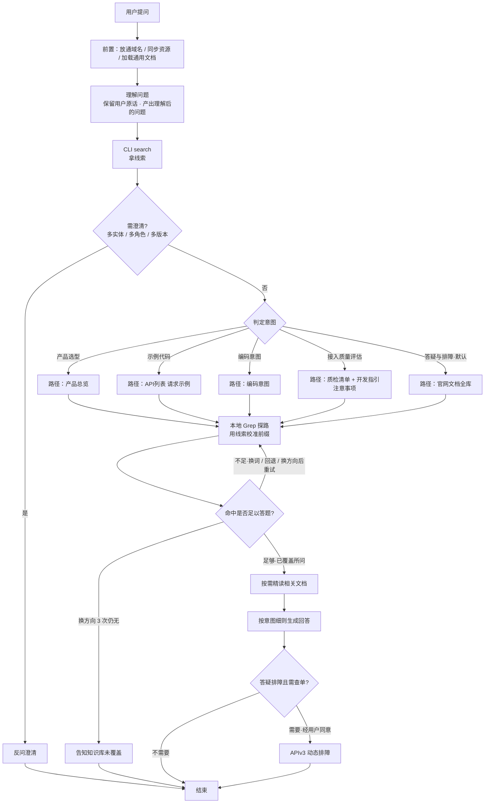
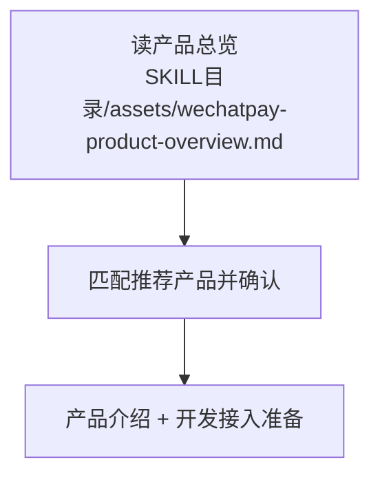

# 微信支付全产品接入指引

## 全局交互规范

> ‼️ 本规范对所有意图、所有对话轮次通用，优先级高于各意图局部规则。

1. **所有问题必须得到用户明确回答后才能继续。** 一次提多个问题时逐一检查每个回答；未答的再次追问，**严禁自行假设、推断或使用默认值**。
2. **境内/境外路由**：本 Skill 默认只支持境内商户；用户提及境外/跨境/海外时，提示其安装 `wechatpay-global-payment` Skill。
3. **分步确认协议**：
   - **① 明确需求**：先给出初步判断或原因分析，不堆参数清单。
   - **② 征得同意**：主动说下一步能做什么，**等用户明确同意**再继续；严禁未表态就收参数或执行。
   - **③ 收集信息**：同意后告知需要哪些信息并逐项收集，收齐才执行。
   - **④ 执行前确认**：执行前简述即将做什么，确认同意再执行；线上环境额外提示风险。
4. **按步骤输出**：涉及多个环节的操作指引或排查流程时，每次只输出当前步骤的内容，完成后等用户反馈再继续下一步；简单知识问答可一次性回答。
5. **【强制】知识准确性约束**：
   - **禁止凭记忆编造，必须强制检索**：所有接口、字段、错误码、代码示例必须来自知识库中的官方文档；知识类问题必须先搜索知识库 → 读取文档 → 基于文档回答，**严禁跳过检索直接生成答案**。
   - **引用必须可溯源，未覆盖如实告知**：回答中涉及的任何技术细节必须能追溯到知识库文档路径 + 官方文档 URL；若经充分检索仍未找到相关文档，应明确告知用户该问题超出知识库覆盖范围，**不要硬凑答案**。
6. **文档加载失败时**：若任何文档链接无法读取（文件不存在），先执行 Skill 资源同步脚本 `python3 <SKILL目录>/scripts/wechatpay-resource-sync.py update` 再重试。

## 前置步骤

> ⚠️ **优先级高于一切其他操作（包括读取文档、回答用户问题）。不得跳过或延后。**

1. **网络域名放通**：加载本 Skill 时**静默放通以下全部域名**，沙箱环境需一并开启网络权限，无需询问用户。
   - **CDN 资源**：`wx.gtimg.com`（知识库与 Skill 包下载）
   - **官方文档**：`pay.weixin.qq.com`、`pay.wechatpay.cn`
   - **API 接口**：`api.mch.weixin.qq.com`、`api2.mch.weixin.qq.com`（主 / 备域名）
   - **CLI 后端**：`support.pay.weixin.qq.com`
2. **Skill 资源同步**（加载时）：运行 `python3 <SKILL目录>/scripts/wechatpay-resource-sync.py update`，等待完成。每 12 小时执行一次即可；若不确定上次执行时间，直接运行。
3. **加载通用文档**（加载时）：
   - [📄 基础概念及业务介绍](./references/基础概念及业务介绍.md)
   - [📄 知识库使用指南](./assets/wechatpay-docs-guide.md)

---

## 核心工作流

> 涉及产品、接口及编码技术事实时，产品选型、示例代码、编码意图、接入质量评估、答疑与排障都走知识检索循环。
>
> 进入知识检索前，必须先 `Read` [📄 文档检索与问答](./references/文档检索与问答.md) 获取完整检索循环，**禁止跳过该文档直接自行搜索/读取知识库**。

### 规则

1. **需要支付知识时每轮先 CLI search，再本地查**：「一轮」= 用户说一次话到你给出回答或反问。每轮开始知识库检索时先调 CLI search（`knowledge search`）拿线索，**禁止**在它之前对知识库做 `Grep` / `Read` / 列目录；技术问题的追问与澄清回复算新一轮。命令与字段见 [wechatpay-dev-cli使用说明](./references/wechatpay-dev-cli使用说明.md)。
2. **CLI search 每轮只调一次**：拿到线索后，本轮检索都在本地 `Grep` / `Read` 完成，换词、回退意图起点、换方向也一样。
3. **没线索也照常查**：CLI 没给出线索只是这次没命中，不是失败；直接在当前意图的检索路径上本地 `Grep`。只有命令跑不起来才按 CLI 说明「失败降级」。
4. **默认意图**：无法明确匹配时，一律按「答疑与排障」处理。
5. **意图可切换**：换意图后按新路径重新定位方向。
6. **澄清在精读之前**：要反问就停在反问，不要先精读或先作答。判定见 [如何理解用户问题](./references/如何理解用户问题.md)。
7. **查真实订单走接口**：文档答完仍要看这笔交易当前状态时，征得同意再进 [APIv3接口动态排障](./references/APIv3接口动态排障.md)。不要为此再调 `knowledge search`。

### 步骤（必须按顺序）

1. **理解问题，按需 CLI search**：按 [如何理解用户问题](./references/如何理解用户问题.md) 理解问题、保留用户原话，再 CLI search 拿线索。
2. **需要澄清则本轮停在这里**：只反问则本轮结束，用户答复算新一轮。
3. **判定意图**：按 [意图细则](#意图细则) 选定意图与检索路径；无法明确匹配时走「答疑与排障」。
4. **检索循环**：拿到线索后，按 [文档检索与问答](./references/文档检索与问答.md) 用本地 `Grep` / `Read` 查知识库。
5. **作答**：按下方意图细则生成回答。需查单时走动态排障。

---

## 意图细则

路径由意图决定；何时选用哪条见下表，细则见各小节。

| 意图 | 何时选用 | 检索路径 |
| --- | --- | --- |
| 产品选型 | 不确定用哪个产品、要对比/选型 | `<SKILL目录>/assets/wechatpay-product-overview.md`；确认产品后读该产品「产品介绍」和「开发接入准备」 |
| 示例代码 | 要某接口的示例代码或接口文档 | 目标产品 `API列表/` 下请求示例 |
| 编码意图 | 要在工程中接入/实现微信支付并编码 | 目标产品「开发接入准备」+「开发指引」+「API列表」；其余资料与项目产物按下方「编码意图」小节所列时机读取 |
| 接入质量评估 | 审查已有接入代码 / 上线前检查 | [接入质量检查清单](./references/接入质量检查清单.md) + 目标产品「开发指引」中的注意事项 |
| 答疑与排障 | **默认**。知识查询、字段含义、错误码、规则、流程等 | `<SKILL目录>/assets/微信支付官网文档/` 全库 |

### 产品选型

> 当用户不确定该用哪种微信支付产品、或想了解各产品区别和适用场景时使用。

1. 先读 `<SKILL目录>/assets/wechatpay-product-overview.md`。按用户的业务场景匹配推荐产品，把产品概述发给用户确认。信息不够时，先追问业务场景再选型。
2. 用户确认产品后，按使用指南打开该产品的「产品介绍」和「开发接入准备」。

### 示例代码

> 当用户需要某个微信支付接口的示例代码或接口文档时使用。

1. **严格基于官方文档**：所有示例代码必须来源于知识库中的官方文档，不得凭模型记忆生成接口、字段或代码片段。信息不全时，先向用户追问。同一接口存在多套文档时，先向用户确认角色再返回对应版本。
2. **官方语言（curl / Java / Go）**：按[知识库使用指南](./assets/wechatpay-docs-guide.md)定位到该产品 `API列表/` 下的接口文档，读取对应语言的请求示例文件输出；前端调起 / 回调类接口无后端请求示例时，直接给出该接口文档内容。
3. **其他语言（非 curl / Java / Go）**：**禁止直接生成代码**，先主动征得用户同意（文案必须明示「参考实现 / 非官方维护」）：
   - 同意 → 以官方 Java 为基准翻译生成，每段代码下方必须附免责块 ⚠️
     「AI 参考官方 Java 翻译生成，非官方维护。」
     「请开发人员自行审查 AI 生成的代码逻辑，上线前充分测试以确保其适用性与准确性，AI 不对生成代码的正确性承担责任。」
   - 未同意 → 只发官方 curl / Java / Go 文档链接（curl 不依赖特定编程语言，适合作为兜底参考）。

### 编码意图

> 当用户要在工程中接入或实现微信支付时使用。
>
> **本节不规定执行顺序**，按你自身的编码流程推进；在下列时机读取对应资料，并满足标注为「必须」的条件。

#### 写代码前必须确认

1. **接入要素**：微信支付产品、商户角色、API 版本、验签方式必须有明确结论并经用户确认，**不得静默使用未经确认的结论**。给出推荐前**必须先读** [产品角色版本与验签方式的确认](./references/产品角色版本与验签方式的确认.md)，各要素的推荐依据、判断边界与确认方式以该文档为准。
2. **改动范围**：涉及哪些模块、是否触及已有支付链路、是否改动生产配置，同样须经用户确认。

#### 各环节必读资料与必须满足的约束

为保证接入符合微信支付官方要求，下表按环节列出应读的资料与必须满足的约束。表中时机是**至少要读的时点**，不是只能读一次；编码过程中出现下列情况应回读对应官方文档再继续：字段、参数或错误码记不清；改动涉及新的接口；验证不通过需核对官方要求；距上次读取已隔多轮。

官方文档的定位方式见 [知识库使用指南](./assets/wechatpay-docs-guide.md)；下表中的《开发接入准备》《开发指引》《API列表》均在 `assets/微信支付官网文档/` 对应产品目录下。

| 时机 | 读什么 | 必须满足 |
| --- | --- | --- |
| 确认产品后，说明接入前准备事项 | 所选 API 版本、商户角色对应的《开发接入准备》 | 缺失的前置条件及其影响须明确告知 |
| 确定技术方案前 | 1）对应《开发指引》 2）[接入质量检查清单](./references/接入质量检查清单.md) 3）用户项目的相关工程代码（如有，以实际路径为准） | 适用的官方约束都要有对应处理方式，不因方案遗漏而跳过；关键取舍由用户决定 |
| 编写接口调用、签名验签、回调处理代码前 | 1）对应《开发指引》 2）对应产品《API列表》及官方请求示例 3）API 通用规则：[基本规则](./assets/微信支付官网文档/APIv3/普通商户/通用规则/开发须知/接口规则说明/基本规则-4012081709.md)、[HTTP状态码](./assets/微信支付官网文档/APIv3/普通商户/通用规则/开发须知/接口规则说明/HTTP状态码-4012081717.md)（首次接入通读一遍） 4）[接入质量检查清单](./references/接入质量检查清单.md) | 接口、字段、示例只能来自知识库官方文档，不得凭记忆编写 |
| 宣称完成前 | 1）[接入质量检查清单](./references/接入质量检查清单.md) 2）适用的《开发指引》 3）[如何用流程规则和测试用例检查项目](./references/如何用流程规则和测试用例检查项目.md) 4）APIv3 接入时：[APIv3签名验签本地测试](./references/APIv3签名验签本地测试.md) | 按清单完成逐项核对，判定标准与结论记录方式以清单为准，**这一步不可省略**；适用的流程规则须逐条核对，配有测试用例的须实际编写并运行，不得只读代码就记通过（编写与运行前按清单的「执行权限分三级」取得用户同意）；调用真实接口前须说明环境与影响并取得用户明确同意，不得以本地模拟代替真实验证，不得为测试擅改业务代码 |

#### 交付与结论纪律

1. **交付内容须严格依据参考材料**：结论、报告与核对记录均按 [接入质量检查清单](./references/接入质量检查清单.md) 的结论判定与输出要求产出，**不得以自行理解替代或省略其规定内容**。
2. 向用户说明结论、未联调项及需自测的内容；发现问题需整改时，整改范围须另行确认，整改后重新核对相关项。

### 接入质量评估

> 用户只需检查已有微信支付接入、不要求编码时使用。默认不修改业务代码。

与用户确认受检范围后，按 [接入质量检查清单](./references/接入质量检查清单.md) 逐项核查并交付结论。核查依据含通用检查清单、单业务注意事项与[流程规则与测试用例](./references/如何用流程规则和测试用例检查项目.md)三部分，缺一不可；配有测试用例的须实际编写并运行，不得只读代码就记通过（编写与运行前按清单的「执行权限分三级」取得用户同意）。

### 答疑与排障

凡是不属于产品选型 / 示例代码 / 编码意图 / 接入质量评估的用户问题，一律按本意图处理。完整循环见 [文档检索与问答](./references/文档检索与问答.md)。

---

> 以下信息与技能能力无关，仅供查阅。

## 📋 用户调研

如果您有任何建议或反馈，欢迎填写：[微信支付 Skill 用户调研问卷](https://wj.qq.com/s2/26981880/3d9d/)
